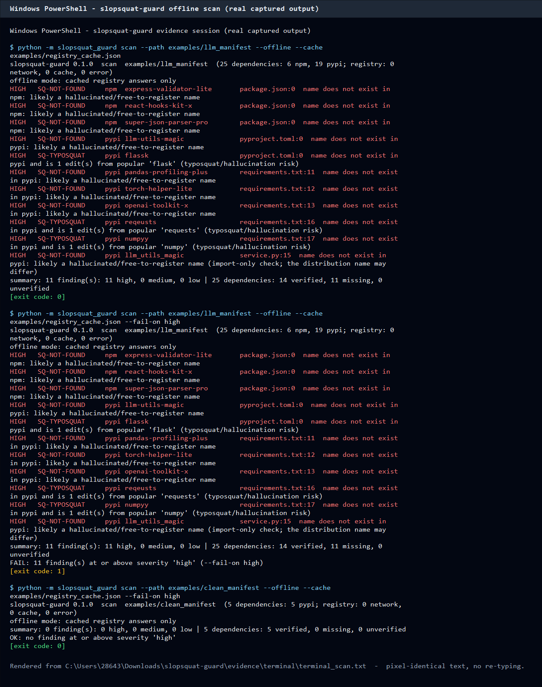

# slopsquat-guard

[](https://github.com/Qin-Z-x/slopsquat-guard/actions/workflows/ci.yml)
[](LICENSE)
[](pyproject.toml)
[](scripts/check_core_deps.py)

**Find hallucinated and typosquatted dependencies before you install them** — extract
Python imports and `requirements.txt` / `pyproject.toml` / `package.json`
dependencies, verify every name against the real PyPI/npm registries, and flag
names that **do not exist** (free for an attacker to register) or sit **one or two
edits away** from a popular package. Standard-library-only Python core, injectable
registry client, offline cache mode.

```console
$ python -m slopsquat_guard scan --path examples/llm_manifest --offline --cache examples/registry_cache.json
slopsquat-guard 0.1.0  scan  examples/llm_manifest  (25 dependencies: 6 npm, 19 pypi; registry: 0 network, 0 cache, 0 error)
offline mode: cached registry answers only
HIGH   SQ-NOT-FOUND      npm  express-validator-lite         package.json:0  name does not exist in npm: likely a hallucinated/free-to-register name
HIGH   SQ-NOT-FOUND      npm  react-hooks-kit-x              package.json:0  name does not exist in npm: likely a hallucinated/free-to-register name
HIGH   SQ-NOT-FOUND      npm  super-json-parser-pro           package.json:0  name does not exist in npm: likely a hallucinated/free-to-register name
HIGH   SQ-NOT-FOUND      pypi llm-utils-magic                pyproject.toml:0  name does not exist in pypi: likely a hallucinated/free-to-register name
HIGH   SQ-TYPOSQUAT      pypi flassk                         pyproject.toml:0  name does not exist in pypi and is 1 edit(s) from popular 'flask' (typosquat/hallucination risk)
HIGH   SQ-NOT-FOUND      pypi pandas-profiling-plus          requirements.txt:11  name does not exist in pypi: likely a hallucinated/free-to-register name
HIGH   SQ-NOT-FOUND      pypi torch-helper-lite              requirements.txt:12  name does not exist in pypi: likely a hallucinated/free-to-register name
HIGH   SQ-NOT-FOUND      pypi openai-toolkit-x               requirements.txt:13  name does not exist in pypi: likely a hallucinated/free-to-register name
HIGH   SQ-TYPOSQUAT      pypi reqeusts                       requirements.txt:16  name does not exist in pypi and is 1 edit(s) from popular 'requests' (typosquat/hallucination risk)
HIGH   SQ-TYPOSQUAT      pypi numpyy                         requirements.txt:17  name does not exist in pypi and is 1 edit(s) from popular 'numpy' (typosquat/hallucination risk)
HIGH   SQ-NOT-FOUND      pypi llm_utils_magic                service.py:15  name does not exist in pypi: likely a hallucinated/free-to-register name (import-only check; the distribution name may differ)
summary: 11 finding(s): 11 high, 0 medium, 0 low | 25 dependencies: 14 verified, 11 missing, 0 unverified

$ python -m slopsquat_guard scan --path examples/clean_manifest --offline --cache examples/registry_cache.json --fail-on high
summary: 0 finding(s): 0 high, 0 medium, 0 low | 5 dependencies: 5 verified, 0 missing, 0 unverified
OK: no finding at or above severity 'high'
```

In the synthetic "LLM-written" manifest, **11 of 25 dependency names are flagged
high**: 8 invented names that do not exist in the registry and 3 near-miss typos
(`reqeusts`→`requests`, `numpyy`→`numpy`, `flassk`→`flask`). The control manifest
made only of real packages passes cleanly. A live PyPI/npm run reproduced the same
11 findings (23 real registry answers, recorded in [`docs/EVIDENCE.md`](docs/EVIDENCE.md)).

## Why this matters (prior art, cited honestly)

| Threat | What it abuses | Reference |
| --- | --- | --- |
| **Package hallucination** | Code-generating LLMs invent plausible package names; the model recommends `pip install <name>` for a package that has never existed | Spracklen et al., *We Have a Package for You!*, [arXiv:2406.10279](https://arxiv.org/abs/2406.10279) — 19.7% of recommended packages did not exist across tested models |
| **Slopsquatting** | An attacker registers a hallucinated name in advance; the next developer who runs the model's install command downloads attacker code | Term coined by Seth Larson (Python Software Foundation); overview: [Socket glossary](https://socket.dev/glossary/slopsquatting) |
| **Typosquatting** | Near-miss names (`reqeusts`, `numpyy`, `flassk`) are registered and installed instead of the real package | [OWASP LLM03:2025 Supply Chain](https://genai.owasp.org/llmrisk/llm032025-supply-chain/); classic supply-chain attack class |
| **Trusted-install pipelines** | Manifests generated by an LLM are installed by CI without review | This tool's `--fail-on high` gate |

**Honest scope and caveat.** Registry presence **does not mean a package is safe**.
A package that exists can still be malicious, abandoned, typo-squatted already, or
not the package the model meant. This tool flags *names* that are absent or
near-misses of popular names — a targeted "hallucination / typosquat" signal, not
a malware scanner and not a guarantee. See
[`docs/THREAT_MODEL.md`](docs/THREAT_MODEL.md) for the threat model and
[`docs/DATA_SOURCES.md`](docs/DATA_SOURCES.md) for how the bundled popularity lists
were built.

## Install

```bash
git clone https://github.com/Qin-Z-x/slopsquat-guard.git
cd slopsquat-guard
python -m pip install -e .          # optional: installs the `slopsquat-guard` CLI
```

No runtime dependencies. Python 3.10+ (the `tomllib` fallback keeps 3.10 working).

## CLI

```text
slopsquat-guard scan   [--path FILE_OR_DIR] [--json] [--fail-on {low,medium,high}]
                       [--offline] [--cache PATH] [--ttl-days N] [--refresh]
                       [--allow NAME ...] [--manifests-only]
slopsquat-guard verify <name> [--ecosystem {pypi,npm}] [--json] [--fail-on ...]
                       [--offline] [--cache PATH]
```

| Exit code | Meaning |
| --- | --- |
| `0` | success; for `scan`/`verify`, no finding at or above `--fail-on` |
| `1` | `--fail-on` threshold reached (CI gate) |
| `2` | usage error, missing path, invalid input |

Examples:

```bash
# CI gate on a manifest folder: fail if any dependency name is missing or a typo
python -m slopsquat_guard scan --path . --fail-on high

# Machine-readable report
python -m slopsquat_guard scan --path . --json

# Offline, deterministic run against a cache snapshot (no network in CI)
python -m slopsquat_guard scan --path . --offline --cache examples/registry_cache.json

# Verify one name before adding it
python -m slopsquat_guard verify reqeusts --fail-on high
python -m slopsquat_guard verify react --ecosystem npm

# Skip known-internal names (comma-separated or repeated)
python -m slopsquat_guard scan --path . --allow my-internal-pkg,example-utils
```

## Python API

```python
from slopsquat_guard import scan_path, verify_package, RegistryClient

result = scan_path(".")                          # dict: dependencies, findings, summary
one    = verify_package("reqeusts", "pypi")      # dict: registry answer + near-miss + finding

# Injectable fetcher: tests and custom registries can supply their own
client = RegistryClient(fetcher=lambda url, timeout=15: (404, b"{}"))
result = scan_path(".", client=client)
```

`RegistryClient(fetcher=..., cache_path=..., ttl_days=..., offline=..., refresh=...)`
isolates all network I/O: the default fetcher uses `urllib`; tests use a
deterministic fake. JSON shapes are published as JSON Schemas:
[`finding`](docs/finding.schema.json), [`scan-result`](docs/scan-result.schema.json),
[`verify-result`](docs/verify-result.schema.json).

## What is extracted and checked

| Source | What is extracted |
| --- | --- |
| Python `*.py` (AST) | top-level modules from `import x` / `from x import y`; stdlib, relative imports and local modules are ignored; curated import→distribution aliases (`PIL`→Pillow, `yaml`→PyYAML, `sklearn`→scikit-learn, …) |
| `requirements.txt` / `constraints*.txt` | names + specifiers, extras/markers stripped, `-r`/`-c` includes followed, URL/VCS/editable entries skipped |
| `pyproject.toml` | `[project].dependencies`, `[project.optional-dependencies]`, `[build-system].requires`, `[tool.poetry.dependencies]`, `[dependency-groups]`; `tomllib` on 3.11+, built-in fallback parser on 3.10 |
| `package.json` | `dependencies`, `devDependencies`, `peerDependencies`, `optionalDependencies`; `workspace:`/`file:`/`link:`/`portal:`/git/`npm:` specs skipped; scoped names kept |

Each name is checked against the ecosystem's public registry:

| Ecosystem | Endpoint | 404 means | other/network error |
| --- | --- | --- | --- |
| PyPI | `https://pypi.org/pypi/<name>/json` | missing (`SQ-NOT-FOUND`) | unverified (`SQ-UNVERIFIED`), never "missing" |
| npm | `https://registry.npmjs.org/<name>` | missing | unverified |

Near-miss detection uses optimal-string-alignment distance (adjacent transposition
costs 1) against the bundled top-1000 popularity lists (`slopsquat_guard/data/`):
distance 1 (1–7 chars) or ≤2 (8+ chars) from a popular name → `SQ-TYPOSQUAT`
(high if the name is missing, medium if it exists but looks like a typo).

## Rules and severity

| Rule | Severity | Meaning |
| --- | --- | --- |
| `SQ-NOT-FOUND` | high | name does not exist in the registry: free for an attacker to register (hallucination risk) |
| `SQ-TYPOSQUAT` | high (missing) / medium (exists) | name is 1–2 edits from a popular package |
| `SQ-UNVERIFIED` | low | registry could not be reached or returned an unexpected status; **not** treated as missing |

Findings are sorted deterministically by `(source_file, line, code, ecosystem, name)`.
`summary` reports dependency counts, registry answers, typosquat suspects and
registry call sources (network / cache / error / offline).

## Reproducible demo and evidence

* Synthetic "LLM-style" project in [`examples/llm_manifest/`](examples/llm_manifest/)
  (invented names are labelled as such in comments) and a real-package control
  manifest in [`examples/clean_manifest/`](examples/clean_manifest/).
* Committed real registry snapshot [`examples/registry_cache.json`](examples/registry_cache.json)
  powers deterministic offline runs in CI.
* Full evidence: [`docs/EVIDENCE.md`](docs/EVIDENCE.md) — offline and live scan
  results, real HTTP statuses, single-name verification, CLI exit codes, tests.
* Screenshots: [`docs/screenshots/`](docs/screenshots/).
* Video material: [`docs/video_assets.md`](docs/video_assets.md).

**Measured on the build machine** (reproducible via `python scripts/capture_evidence.py`):

| Check | Result |
| --- | --- |
| Offline scan of synthetic manifest | **11 findings** (11 high): 8 missing + 3 typosquat suspects, 25 dependencies |
| Real packages flagged by mistake | **0** (14 real dependency names verified, none reported) |
| Control real-package manifest | **0 findings**, `--fail-on high` exit 0 |
| Live registry run (real PyPI/npm HTTP) | **same 11 high findings**, 23 real registry answers |
| Determinism | offline scan JSON identical across runs (sha256 in evidence) |
| Tests | **92 tests**, all passing |



## Development and tests

```bash
python scripts/check_core_deps.py                # stdlib-only core check
python -m unittest discover -s tests -t .         # 92 tests (mocked registry fetcher)
python -m pytest                                  # same tests through pytest
python scripts/refresh_popularity.py              # regenerate bundled popularity lists (network)
python scripts/capture_evidence.py                # regenerate EVIDENCE.md + raw evidence + screenshots
```

CI (`.github/workflows/ci.yml`) runs on GitHub Actions for Python 3.10–3.13:
stdlib-only check, `unittest`, `pytest`, deterministic **offline** scans against the
committed cache snapshot (no network), both gate outcomes, single-name verify, and
the JSON schema tests.

## Repository layout

```text
slopsquat_guard/       # core: extraction, registry client, typosquat detection, CLI
slopsquat_guard/data/  # bundled top-1000 popularity lists (with cited headers)
tests/                 # 92 unittest/pytest tests with a mocked registry fetcher
docs/                  # THREAT_MODEL, EVIDENCE, DATA_SOURCES, JSON Schemas, screenshots
examples/              # synthetic LLM-style manifests + real-package control + cache snapshot
scripts/               # data refresh, evidence capture, terminal screenshot renderer
evidence/              # raw captured evidence (scans, registry cache, CLI runs, test output)
.github/workflows/ci.yml
```

## Limitations and responsible use

* Registry presence ≠ safety: existing packages can be malicious or wrong for the
  intended purpose. This tool only flags absent names and near-misses.
* Import-name vs distribution-name mapping is curated, not complete: an unmapped
  import name that is not on PyPI is reported high but marked "import-only" — use
  `--allow` for internal/vendored distributions.
* Private registries and vendored packages are out of scope; use `--allow`.
* Offline mode is deterministic but stale by design; the cache TTL (default 7 days)
  applies online.
* Popularity lists are dated download rankings, not security endorsements. Scoped
  npm names are excluded from the bundled npm ranking because the bulk downloads
  API does not support them.
* Use for defence: gate LLM-generated manifests in CI and review pipelines. No
  claims about a particular model's hallucination rate beyond the cited paper.

## Suggested GitHub topics

`security`, `llm`, `ai-safety`, `supply-chain`, `slopsquatting`,
`package-hallucination`, `typosquat`, `pypi`, `npm`, `python`

## 中文简介

**slopsquat-guard** 用于在安装前发现“LLM 幻觉依赖”与“拼写仿冒（typosquat）”风险：
从 Python 导入语句、`requirements.txt`、`pyproject.toml`、`package.json` 中提取依赖名，
通过 PyPI / npm 公共注册表**验证名称是否存在**；不存在的名字说明任何人都可以抢注
（slopsquatting），与热门包仅差 1–2 个编辑距离的名字则标记为高风险 typosquat。

核心仅用 Python 标准库，注册表访问可注入（便于测试），自带真实下载量 Top-1000 热门包
静态列表（附数据来源与生成日期）与离线缓存模式；CLI 支持 `--json`、`--fail-on high`
CI 门禁、`--offline` 离线确定性与单包 `verify`。示例的“LLM 风格”清单中 **25 个依赖里
11 个被标为 high**（8 个不存在的虚构名 + 3 个近似拼写），而真实包对照组 0 告警；
真实联网扫描得到同样的 11 个结果，92 个单元测试全部通过。

**重要诚实声明**：注册表里存在 ≠ 安全。本工具只回答“名字是否存在/是否近似热门包”，
不是恶意软件扫描器，也不保证模型推荐的包就是它想要的包。详见
[`docs/THREAT_MODEL.md`](docs/THREAT_MODEL.md)。

## License and acknowledgements

MIT — see [LICENSE](LICENSE). Prior art: package-hallucination measurement by
Spracklen et al. (arXiv:2406.10279), the term "slopsquatting" coined by Seth
Larson (Python Software Foundation), OWASP LLM03:2025 Supply Chain, and the
public PyPI/npm registries and datasets used for the popularity lists
(see [`docs/DATA_SOURCES.md`](docs/DATA_SOURCES.md)). This project is independent
and not affiliated with those authors or projects.
